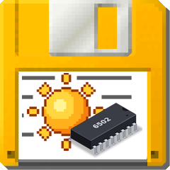

# SunshineLink

**Sun6502 Mini IDE & CMD** – a small Windows Forms program for writing BASIC on a PC and sending it to a Sun6502 computer over RS232.

> *Let there be sunshine on your 6502.*

## Features

- **Code editor** with Ln/Col status, load/save (`.bas` / `.txt`, Latin-1 so file bytes are preserved) and an unsaved-changes prompt
- **RS232 terminal**: Direct control and monitor of the computer
- **Send program**: Sending your program and run it without doing it manually
- **Send timing**: separate *line delay* and *char delay*, for cases when you modify the computer or when flow control fails.
- **Serial setup**: any COM port, 300 – 115200 baud, 8N1, flow control *none / RTS-CTS / XON-XOFF*
- **MS BASIC helpers** (Options menu):
  - auto line numbers (step 10) for lines that have none
  - send in UPPERCASE (text inside quotes is left alone)
  - send `NEW` before and/or `RUN` after the program
- **Break** with the Pause/Break key, Ctrl+X in the terminal, or the toolbar button (sends Ctrl-C, `$03`)
- **BASIC reference window** (F1): searchable list of commands with syntax and description, loaded from an editable `commands.ini`

Basically like any other terminal, but more convenient to use with Sun6502.

## Requirements

- Windows XP or newer
- .NET Framework 4.0 or newer
- A serial port or USB-serial adapter

To build: **Visual Studio 2010** or newer (C#). The project uses only C# 4.0 features, so it opens in anything from VS2010 up.

## Usage

1. Plug in your serial adapter, pick the **Port**, set the **Baud** rate and flow control, and click **Connect**.
2. Click the terminal and type away. (You should init BASIC by typing C000R)
3. Write a BASIC program in the editor and press **F5** (**▶ Send program**).
4. If characters get lost, increase the delays (see below).

If you aren't sure what settings to set, leave the defaults.

### Send timing

| Setting | What it does | Typical value |
|---|---|---|
| **Line delay** | pause after each complete line, so BASIC can tokenize and store it | 100 ms |
| **Char delay** | pause after every character, for ROMs that can't keep up within a line | 0 – 10 ms |

Sun6502 has Flow Control so even then delays set to 0 it should not lose any data.

### Keyboard

| Key | Action |
|---|---|
| **F5** | Send program |
| **F1** | BASIC reference |
| **Pause/Break**, **Ctrl+X** (in terminal) | Break – sends Ctrl-C (`$03`) |
| **Ctrl+C** / **Ctrl+Insert** (in terminal) | Copy selected terminal text |
| **Ctrl+V** (in terminal) | Send clipboard text to the computer, line by line |
| **Ctrl+A … Ctrl+Z** (in terminal) | Send the matching control code (except C, V, X) |
| **Ctrl+N / O / S**, **Ctrl+Shift+S** | New / Open / Save / Save As |
| Right-click in terminal | Copy / Clear |

## Sun6502 BASIC reference (`commands.ini`)

The help window reads its data from `commands.ini`.
Easy to modify if you need too.

## Running on Linux / macOS

No. Linux maybe with Mono but modern macOS...just no

### Credits and Attribution

The application icon is based on the [Total Commander logo](https://commons.wikimedia.org/wiki/Category:Total_Commander) by Christian Ghisler, obtained from Wikimedia Commons and modified for this application. Licensed under [CC BY-SA 4.0](https://creativecommons.org/licenses/by-sa/4.0/). The modified icon is distributed under the same licence.